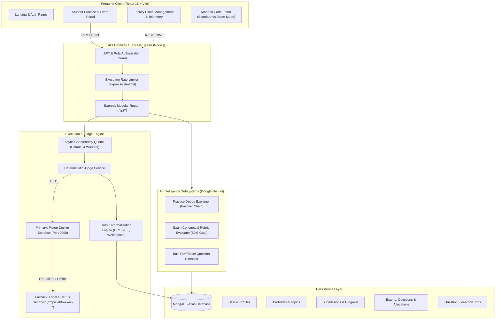
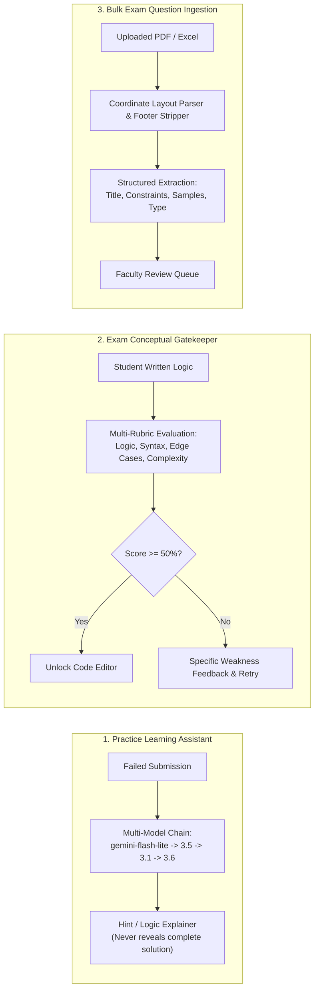
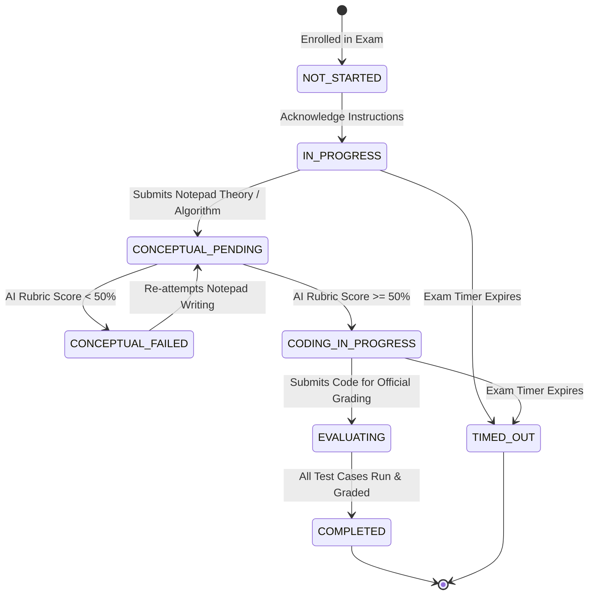

# CLABTOPro Platform — Master Technical Documentation & System Manual

**ClabToPro** is an enterprise-grade academic online judging, learning assistance, and examination platform tailored for C programming laboratory curricula in engineering institutions. Built with high concurrency and strict academic integrity in mind, it comfortably serves 120+ simultaneous students executing and submitting code in real time.

---

## Table of Contents

1. [Executive Summary & Academic Context](#1-executive-summary--academic-context)
2. [High-Level Architecture & Data Flow](#2-high-level-architecture--data-flow)
3. [Dual Sandboxed Execution & Deterministic Judge Engine](#3-dual-sandboxed-execution--deterministic-judge-engine)
4. [Artificial Intelligence Subsystems](#4-artificial-intelligence-subsystems)
5. [Examination Module & Student State Machine](#5-examination-module--student-state-machine)
6. [Bulk Question Upload & Page-Aware Ingestion Pipeline](#6-bulk-question-upload--page-aware-ingestion-pipeline)
7. [Complete REST API Reference](#7-complete-rest-api-reference)
8. [Database Schema & Data Dictionary](#8-database-schema--data-dictionary)
9. [Frontend Architecture & UI Design System](#9-frontend-architecture--ui-design-system)
10. [Setup, Installation & Configuration Guide](#10-setup-installation--configuration-guide)
11. [Testing, Verification & Maintenance Runbook](#11-testing-verification--maintenance-runbook)

---

## 1. Executive Summary & Academic Context

### 1.1 The Academic Challenge
Undergraduate C programming laboratory courses frequently encounter severe operational bottlenecks:
- **Inconsistent Manual Evaluation:** Faculty spend excessive lab hours evaluating basic syntax, code compilation, and manual test cases rather than mentoring students.
- **Copy-Paste & Academic Dishonesty:** When students receive identical or trivially shared questions, code plagiarism proliferates.
- **Uncontrolled Editor Assistance:** Modern IDEs and online editors supply aggressive autocomplete, Copilot/IntelliSense, and snippet injections, preventing students from mastering fundamental syntax and algorithmic problem-solving.
- **Subjective Theory-to-Code Gap:** Students often write code without thoroughly understanding logic flow, leading to guess-and-check coding rather than structured conceptual reasoning.
- **Faculty Overhead in Exam Prep:** Manually typing 160–200 complex programming questions with multi-line diamond/pyramid patterns and matrices into learning management systems is error-prone and time-prohibitive.

### 1.2 The ClabToPro Solution
ClabToPro solves these challenges through:
1. **Dual-Engine Deterministic Execution:** Sandboxed execution via containerized Piston Docker or local GCC fallback with millisecond-precision timeouts and output normalization.
2. **Pedagogical AI Failover:** Evidence-based failure explanations that guide students without revealing solutions.
3. **Strict 1-to-1 Question Allocation:** Fisher-Yates shuffle engine ensuring every student receives a unique, unshared question in internal/external exams.
4. **Mandatory Conceptual Gate:** Students must articulate their logic and achieve $\ge 50\%$ on an automated AI conceptual evaluation before coding unlocks.
5. **Exam-Hardened Code Editor:** Monaco Editor stripped of IntelliSense, parameter hints, word completion, and suggestions.
6. **Page-Aware PDF/Excel Bulk Ingestion:** Layout-aware extraction engine that eliminates header/footer noise and preserves whitespace-sensitive patterns.

---

## 2. High-Level Architecture & Data Flow

### 2.1 System Architecture Diagram



---

## 3. Dual Sandboxed Execution & Deterministic Judge Engine

### 3.1 Dual-Engine Architecture
The execution engine guarantees high availability and isolation:
1. **Primary Engine — Piston Docker Sandbox:** Executes student C code in an ephemeral, unprivileged Linux container via HTTP API (`http://localhost:2000/api/v2/execute`). Imposes memory limits (128MB), CPU execution limits, and prohibits network access.
2. **Fallback Engine — Local GCC 13 Runner:** If Piston is unreachable or offline, the platform automatically routes the compilation and execution directly to a sandboxed host GCC runner (`backend/services/localGccService.js`).

### 3.2 Local GCC Sandboxing Mechanics
- **Unique Isolated Workspaces:** Each run generates an ephemeral working directory under `/tmp/clabto-exec-<uuid>/`.
- **Source Compilation:** Compiles with modern C flags:
  ```bash
  gcc -O2 -std=c11 -Wall -Werror=implicit-function-declaration source.c -o solution.out -lm
  ```
- **Execution & Timeout Reaper:** Spawns `solution.out` with piped standard input and strict limits:
  - Default wall-clock execution limit: **2000 ms**.
  - Asynchronous timer tracks execution. If exceeded, a `SIGKILL` (`kill -9`) terminates the process tree immediately, yielding `TIME_LIMIT_EXCEEDED`.
- **Guaranteed Cleanup:** `fs.rm(dir, { recursive: true, force: true })` runs in a `finally` block, ensuring no disk pollution or leftover processes.

### 3.3 Output Normalization Engine
To avoid false negatives caused by operating system variations (Windows CRLF vs Unix LF) or harmless trailing whitespace:
```javascript
export const normalizeOutput = (str) => {
  if (typeof str !== "string") return "";
  return str
    .replace(/\r\n/g, "\n")      // Convert Windows CRLF to Unix LF
    .replace(/\r/g, "\n")        // Convert Mac classic CR to Unix LF
    .split("\n")
    .map(line => line.trimEnd()) // Strip trailing spaces per line
    .join("\n")
    .trim();                     // Strip trailing newlines
};
```
> **Special Note for Pattern Questions:** For pattern and matrix questions where spaces within the line define visual layout (e.g. pyramids, diamonds), `trimEnd()` ensures interior formatting is untouched while trailing line garbage is ignored.

### 3.4 Concurrency Worker Pool
- Standard concurrency is governed by `EXECUTION_CONCURRENCY` (default: 4 workers).
- Ensures that spikes in submissions (e.g., during class-wide lab deadlines) are queued gracefully without starving server CPU or crashing memory.

---

## 4. Artificial Intelligence Subsystems

ClabToPro integrates Google Gemini across three distinct pedagogical workflows:



### 4.1 Practice AI Learning Assistant (`backend/services/aiEvaluationService.js`)
- **Evidence-Based Prompting:** Supplies problem statement, constraints, student code, compiler error, and first failing test case.
- **Pedagogical Guardrails:** Explicitly instructed to act as a supportive computer science lab professor: identifies the conceptual misunderstanding or off-by-one error, explains why the code fails, and gives a focused hint without outputting copy-paste C code.
- **Multi-Model Fallback Chain:**
  1. `gemini-2.0-flash-lite` (Ultra-low latency)
  2. `gemini-1.5-flash`
  3. `gemini-1.5-pro`
  4. Deterministic Rule-Based Fallback (Pattern matcher analyzing common GCC errors like `segmentation fault`, `conflicting types`, `undefined reference to sqrt`).

### 4.2 Exam Conceptual Evaluator (`backend/services/examAIService.js`)
- **The 50% Gatekeeper Rule:** In exam mode, a student cannot write executable code until they prove they understand the algorithm.
- **Rubric Dimensions:**
  - Logic & Algorithm: $0 - 40$ points
  - Syntax Understanding & Core Constructs: $0 - 30$ points
  - Edge Cases & Constraints: $0 - 15$ points
  - Time & Space Complexity: $0 - 15$ points
  - Total Maximum: $100$ points.
- **Threshold:** $\text{Overall Score} \ge 50$ marks approval.

### 4.3 Bulk Question Extractor (`backend/services/questionExtractorAIService.js`)
- Ingests raw parsed text chunks from 160–200 question documents.
- Automatically detects question boundaries (`Q1`, `Problem 2`, `Task 3`).
- Determines question classification:
  - `PATTERN`: Asterisk, pyramid, number, or alphabet shape layout.
  - `MATRIX`: 2D array representation with row/column structures.
  - `STANDARD`: General algorithmic or arithmetic logic.
- Generates standard input, expected output, difficulty rating, and suggested tags.

---

## 5. Examination Module & Student State Machine

### 5.1 Internal vs. External Examination Types
- **Internal Exam:** Continuous assessment or midterm lab exam. Allows faculty monitoring, multiple code test runs, and partial score analytics.
- **External Exam:** End-semester practical examination. Imposes maximum security, single submission lock, strict proctoring audits, and randomized 1-to-1 question distribution.

### 5.2 Deterministic Multi-Question Fisher-Yates Allocation Engine
Faculty can specify how many questions ($K$) each student should receive (defaulting to 1). The allocation engine enforces:
$$1 \le K \le N \quad (\text{where } N \text{ is total available questions in the exam bank})$$
1. Exam questions are fetched and indexed.
2. For each participating student, an independent Fisher-Yates shuffle is executed across the question bank.
3. The first $K$ distinct questions from the shuffle permutation are assigned to the student.
4. **Intra-Student Uniqueness Guarantee:** Slicing from a distinct permutation guarantees zero internal duplicate questions for any student.
5. **Cross-Student Combination Diversity:** The algorithm maximizes combination variance across students so students receive distinct question sets wherever possible.
6. The assignment is stored in `ExamAllocation` collection with `assignedQuestionIds: [ObjectId]`, compound index `(examId, studentId)` set to `unique: true`, and locked once the exam starts.

### 5.3 Student Exam 8-State Progression Machine



### 5.4 Exam-Hardened Code Editor
The student exam code editor (`frontend/src/pages/student/ExamCodeEditorPage.jsx`) uses a specialized Monaco Editor configuration:
- `quickSuggestions: false`
- `suggestOnTriggerCharacters: false`
- `parameterHints.enabled: false`
- `wordBasedSuggestions: false`
- `snippetSuggestions: "none"`
- `tabCompletion: "off"`
- `acceptSuggestionOnEnter: "off"`
- `contextmenu: false`
- **Proctoring Telemetry:** Full-screen enforcement, blur detection, and tab-switch event logging recorded in `ExamAuditLog`.

---

## 6. Bulk Question Upload & Page-Aware Ingestion Pipeline

### 6.1 The Page Contamination Challenge
When extracting questions from multi-page PDFs, headers (e.g. `CLABTOPro Midterm 2026`) and footers (e.g. `Page 7 of 15`) frequently pollute problem descriptions or break sample outputs.

### 6.2 Geometry & Coordinate-Aware Filtering
The extraction orchestrator (`backend/services/questionParserService.js`) employs a multi-pass pipeline:
1. **Vertical Coordinate Segmentation:** Extracts text blocks with bounding boxes $(x, y, w, h)$. Blocks falling in the top $8\%$ (header) or bottom $8\%$ (footer) of the page height are pruned.
2. **Dynamic Header/Footer Regex Removal:** Identifies repeated phrases, page numbers (`Page X of Y`, `Page N`), and horizontal rules.
3. **Monospace Visual Preservation:** Preserves leading spaces and tabs within code/pattern blocks to prevent flattening of triangle or diamond outputs.
4. **Multi-Factor Classification Engine:** Identifies patterns using visual symbols (`*`, `#`, `@`), nested loops, and structural triangular growth, distinguishing them from standard string/array manipulation.
5. **Faculty Review & Approval Queue:** Extracted questions are held in a staging collection (`QuestionExtractionJob`) allowing faculty to inspect, edit, or reject before publishing to the live exam.

---

## 7. Complete REST API Reference

### 7.1 Authentication Endpoints (`/api/auth`)
| Method | Route | Description | Access |
|---|---|---|---|
| `POST` | `/api/auth/register` | Register new student account | Public |
| `POST` | `/api/auth/login` | Login and obtain JWT token | Public |
| `GET` | `/api/auth/me` | Fetch authenticated user profile | Bearer Token |
| `POST` | `/api/auth/forgot-password` | Send password reset token to email | Public |
| `POST` | `/api/auth/reset-password/:token`| Reset password via token | Public |

### 7.2 Practice Problems (`/api/problems`)
| Method | Route | Description | Access |
|---|---|---|---|
| `GET` | `/api/problems` | List problems with filters (topic, difficulty) | Authenticated |
| `GET` | `/api/problems/:id` | Get problem details and public sample tests | Authenticated |
| `POST` | `/api/problems` | Create new problem | Faculty / Admin |
| `PUT` | `/api/problems/:id` | Update existing problem | Faculty / Admin |
| `DELETE` | `/api/problems/:id` | Delete problem | Faculty / Admin |

### 7.3 Submissions & Execution (`/api/submissions` & `/api/execution`)
| Method | Route | Description | Access |
|---|---|---|---|
| `POST` | `/api/submissions` | Submit code for official judging | Authenticated |
| `GET` | `/api/submissions` | List user submission history | Authenticated |
| `GET` | `/api/submissions/:id` | Get submission details and verdict | Authenticated |
| `GET` | `/api/execution/health` | Health status of Piston & GCC engines | Public |

### 7.4 Student Progress & Statistics (`/api/progress`)
| Method | Route | Description | Access |
|---|---|---|---|
| `GET` | `/api/progress` | Get current user streak & solved metrics | Authenticated |
| `GET` | `/api/progress/stats` | Aggregated topic mastery stats | Authenticated |

### 7.5 Examination Management (`/api/exams`)
| Method | Route | Description | Access |
|---|---|---|---|
| `POST` | `/api/exams` | Create new exam (Internal/External) | Admin |
| `GET` | `/api/exams/faculty` | List faculty-created exams | Admin |
| `GET` | `/api/exams/students-candidates`| Fetch eligible student roster | Admin |
| `GET` | `/api/exams/:examId` | Fetch exam configuration & question list | Admin |
| `PATCH`| `/api/exams/:examId` | Update exam settings & timings | Admin |
| `DELETE`| `/api/exams/:examId` | Delete exam | Admin |
| `POST` | `/api/exams/:examId/questions` | Manually add question to exam | Admin |
| `PUT` | `/api/exams/questions/:id` | Update exam question | Admin |
| `DELETE`| `/api/exams/questions/:id` | Delete exam question | Admin |
| `POST` | `/api/exams/:examId/students` | Assign participating students to exam | Admin |
| `POST` | `/api/exams/:examId/allocate` | Execute 1-to-1 Fisher-Yates allocation | Admin |
| `GET` | `/api/exams/:examId/allocations`| View student-to-question mappings | Admin |
| `POST` | `/api/exams/:examId/start` | Publish / start exam session | Admin |
| `POST` | `/api/exams/:examId/complete` | Conclude exam session | Admin |
| `GET` | `/api/exams/:examId/monitoring` | Real-time student progress telemetry | Admin |

### 7.6 Bulk Question Upload & Extraction (`/api/exams/:examId/questions/*`)
| Method | Route | Description | Access |
|---|---|---|---|
| `POST` | `.../upload` | Upload PDF or Excel question paper | Admin |
| `GET` | `.../extraction/:jobId` | Check extraction processing status | Admin |
| `GET` | `.../extraction/:jobId/preview` | Preview extracted questions for review | Admin |
| `PATCH`| `.../extraction/:jobId/questions/:qId` | Update an extracted question draft | Admin |
| `DELETE`| `.../extraction/:jobId/questions/:qId` | Discard an extracted question draft | Admin |
| `POST` | `.../extraction/:jobId/approve-all` | Batch-approve all extracted items | Admin |
| `POST` | `.../extraction/:jobId/save` | Commit approved questions to live exam | Admin |

### 7.7 Student Examination Experience (`/api/exams/*`)
| Method | Route | Description | Access |
|---|---|---|---|
| `GET` | `/api/exams/student/list` | List active & upcoming exams for student | Student |
| `GET` | `/api/exams/:examId/instructions` | View exam rules and timings | Student |
| `POST` | `/api/exams/:examId/acknowledge-instructions` | Acknowledge rules & start exam clock | Student |
| `GET` | `/api/exams/:examId/my-question` | Fetch uniquely allocated question | Student |
| `POST` | `/api/exams/:examId/answers/autosave` | Autosave paper notepad draft | Student |
| `POST` | `/api/exams/:examId/answers/evaluate` | Submit notepad logic for AI rubric check | Student |
| `POST` | `/api/exams/:examId/compiler/run` | Test-run code against public samples | Student |
| `POST` | `/api/exams/:examId/compiler/submit` | Final code submission & official grading | Student |
| `GET` | `/api/exams/:examId/completion` | Fetch final completion certificate / report | Student |

---

## 8. Database Schema & Data Dictionary

### 8.1 Core Models

#### `User` (`backend/models/User.js`)
- `name` (String, required)
- `email` (String, required, unique, lowercase)
- `password` (String, hashed with bcrypt)
- `role` (String, enum: `["student", "admin"]`, default: `"student"`)
- `rollNumber` (String, indexed)
- `department` (String)
- `academicYear` (Number)

#### `Problem` (`backend/models/Problem.js`)
- `title` (String, required)
- `description` (String, required)
- `topic` (ObjectId -> Topic)
- `difficulty` (String, enum: `["Easy", "Medium", "Hard"]`)
- `testCases` (Array of `{ input: String, expectedOutput: String, isPublic: Boolean }`)
- `constraints` (String)

#### `Submission` (`backend/models/Submission.js`)
- `userId` (ObjectId -> User, indexed)
- `problemId` (ObjectId -> Problem, indexed)
- `code` (String, required)
- `language` (String, default: `"c"`)
- `verdict` (String, enum: `["ACCEPTED", "WRONG_ANSWER", "COMPILE_ERROR", "RUNTIME_ERROR", "TIME_LIMIT_EXCEEDED"]`)
- `passedTests` (Number)
- `totalTests` (Number)
- `tabSwitches` (Number, default: 0)
- `aiFeedback` (Object: `{ explanation: String, hint: String, failureType: String }`)

---

### 8.2 Examination Models

#### `Exam` (`backend/models/Exam.js`)
- `title` (String, required)
- `examType` (String, enum: `["internal", "external"]`, required)
- `status` (String, enum: `["draft", "scheduled", "active", "completed"]`, default: `"draft"`)
- `startTime` (Date, required)
- `endTime` (Date, required)
- `durationMinutes` (Number, required)
- `createdBy` (ObjectId -> User)
- `instructions` (String)
- `maxScore` (Number, default: 100)

#### `ExamQuestion` (`backend/models/ExamQuestion.js`)
- `examId` (ObjectId -> Exam, indexed)
- `questionNumber` (Number)
- `title` (String, required)
- `description` (String, required)
- `classification` (String, enum: `["PATTERN", "MATRIX", "STANDARD"]`)
- `sampleInput` (String)
- `sampleOutput` (String)
- `hiddenTestCases` (Array of `{ input: String, expectedOutput: String }`)
- `marks` (Number, default: 100)

#### `ExamAllocation` (`backend/models/ExamAllocation.js`)
- `examId` (ObjectId -> Exam, required)
- `studentId` (ObjectId -> User, required)
- `questionId` (ObjectId -> ExamQuestion, required)
- **Indexes:** Compound unique index on `{ examId: 1, studentId: 1 }` and `{ examId: 1, questionId: 1 }`.

#### `StudentExamProgress` (`backend/models/StudentExamProgress.js`)
- `examId` (ObjectId -> Exam)
- `studentId` (ObjectId -> User)
- `status` (String, enum: `["NOT_STARTED", "IN_PROGRESS", "CONCEPTUAL_PENDING", "CONCEPTUAL_FAILED", "CODING_IN_PROGRESS", "EVALUATING", "COMPLETED", "TIMED_OUT"]`)
- `conceptualScore` (Number, $0 - 100$)
- `codingScore` (Number, $0 - 100$)
- `totalScore` (Number)
- `conceptualFeedback` (Object)
- `tabSwitches` (Number, default: 0)
- `startedAt` (Date)
- `completedAt` (Date)

#### `QuestionExtractionJob` (`backend/models/QuestionExtractionJob.js`)
- `examId` (ObjectId -> Exam)
- `fileName` (String)
- `status` (String, enum: `["processing", "completed", "failed"]`)
- `extractedQuestions` (Array of uncommitted question objects with review flags)
- `error` (String)

---

## 9. Frontend Architecture & UI Design System

### 9.1 Technology Stack & Structure
- **Core Framework:** React 18 with Vite.
- **Styling:** Tailwind CSS with custom academic palette and dark mode compatibility.
- **Routing:** React Router v6 with code-splitting via `React.lazy` and `Suspense`.
- **Code Editor:** `@monaco-editor/react`.

```text
frontend/src/
├── components/
│   ├── common/              # Buttons, Cards, Modals, Loaders
│   ├── dashboard/           # Student metrics & streak charts
│   ├── exam/                # Exam header, telemetry pill, guideline panels
│   ├── layout/              # StudentLayout & AdminLayout
│   └── problem/             # Problem description & test case viewer
├── context/
│   └── AuthContext.jsx      # Global user session & JWT storage
├── pages/
│   ├── admin/               # Faculty dashboard, Exam creator, Monitoring
│   ├── auth/                # Login, Register, Password Recovery
│   └── student/             # Practice workspace, Exam session pages
└── routes/
    └── AppRoutes.jsx        # Role-based route protection
```

### 9.2 Route Configuration Table
| Route | Component | Guard | Description |
|---|---|---|---|
| `/` | `Home.jsx` | Public | Landing page |
| `/login` | `Login.jsx` | Public | Authentication |
| `/dashboard` | `Dashboard.jsx` | Protected (Student) | Practice stats, streaks, recommendations |
| `/problems/:id` | `ProblemDetails.jsx` | Protected (Student) | Split-pane practice coding environment |
| `/exams` | `StudentExams.jsx` | Protected (Student) | Enrolled exam dashboard |
| `/exams/:id/instructions` | `ExamInstructions.jsx` | Protected (Student) | Exam rules & acknowledgment |
| `/exams/:id/question` | `ExamAssignedQuestion.jsx` | Protected (Student) | Assigned question viewing |
| `/exams/:id/paper` | `ExamPaperNotepad.jsx` | Protected (Student) | Algorithm & logic conceptual gate |
| `/exams/:id/editor` | `ExamCodeEditorPage.jsx` | Protected (Student) | Exam-hardened code compiler |
| `/exams/:id/completed` | `ExamCompleted.jsx` | Protected (Student) | Final submission report |
| `/admin` | `AdminDashboard.jsx` | AdminRoute | Faculty overview & quick actions |
| `/admin/exams` | `AdminExams.jsx` | AdminRoute | Exam listing & management |
| `/admin/exams/create` | `CreateExam.jsx` | AdminRoute | Multi-step exam creation wizard |
| `/admin/exams/:id` | `AdminExamDetails.jsx` | AdminRoute | Question upload, allocation, live monitoring |

---

## 10. Setup, Installation & Configuration Guide

### 10.1 Prerequisites
- **Node.js:** v18.0.0 or higher
- **npm:** v9.0.0 or higher
- **GCC:** GCC 11+ installed locally (e.g. `sudo apt install build-essential gcc`)
- **MongoDB:** Local MongoDB instance or MongoDB Atlas connection URI
- **Google Gemini API Key:** Active key from Google AI Studio
- *(Optional)* **Docker:** For hosting standalone Piston sandbox

### 10.2 Installation Steps

```bash
# 1. Clone the repository
git clone https://github.com/your-org/ClabToPro.git
cd ClabToPro

# 2. Install backend dependencies
cd backend
npm install

# 3. Install frontend dependencies
cd ../frontend
npm install
```

### 10.3 Backend Environment Configuration (`backend/.env`)
Create `backend/.env` with the following variables:
```env
PORT=5000
NODE_ENV=development
CLIENT_URL=http://localhost:5173

# Database
MONGO_URI=mongodb+srv://<username>:<password>@cluster0.mongodb.net/clabtopro?retryWrites=true&w=majority

# Security
JWT_SECRET=your_super_secret_jwt_key_here
JWT_EXPIRES_IN=7d

# Execution & Judging
PISTON_URL=http://localhost:2000/api/v2
EXECUTION_CONCURRENCY=4
EXECUTION_TIMEOUT_MS=2000

# Google Gemini AI
GEMINI_API_KEY=AIzaSy...your_gemini_api_key

# Email Service (Optional for password reset)
SMTP_HOST=smtp.gmail.com
SMTP_PORT=587
SMTP_USER=your_email@gmail.com
SMTP_PASS=your_app_password
```

### 10.4 Frontend Environment Configuration (`frontend/.env`)
Create `frontend/.env` with the following:
```env
VITE_API_URL=http://localhost:5000/api
```

### 10.5 Running Locally

```bash
# Terminal 1: Start Backend Server
cd backend
npm run dev

# Terminal 2: Start Frontend Development Server
cd frontend
npm run dev
```
Open [http://localhost:5173](http://localhost:5173) in your browser.

---

## 11. Testing, Verification & Maintenance Runbook

### 11.1 Automated Test Execution
The backend includes automated test suites covering bulk upload, geometry parsing, and exam allocation logic:

```bash
# Run all unit and integration test suites
node --test backend/tests/bulkQuestionUpload.test.js backend/tests/exam.test.js
```
*Expected Result:* 27/27 tests passing.

```bash
# Verify Frontend Production Build
npm --prefix frontend run build
```
*Expected Result:* Clean Vite production build with zero chunk errors.

### 11.2 Operational Troubleshooting

| Symptom | Probable Cause | Action / Resolution |
|---|---|---|
| `Piston unreachable` warning in logs | Docker Piston is offline | System automatically falls back to `localGccService.js`. Verify `gcc --version` is present on host. |
| AI failure explanation fallback triggered | Gemini API rate limit or invalid key | Check `GEMINI_API_KEY` validity; fallback engine continues serving rule-based feedback. |
| Student editor shows autocomplete | Normal practice mode active | Verify route: Autocomplete is deliberately disabled only in `/exams/:id/editor`. |
| PDF Question Extraction fails | Scanned image PDF uploaded | Instruct faculty to upload text-based PDFs generated via MS Word/Docs as stated in upload guidelines. |

---

*Authored by Antigravity Engineering for ClabToPro.*
