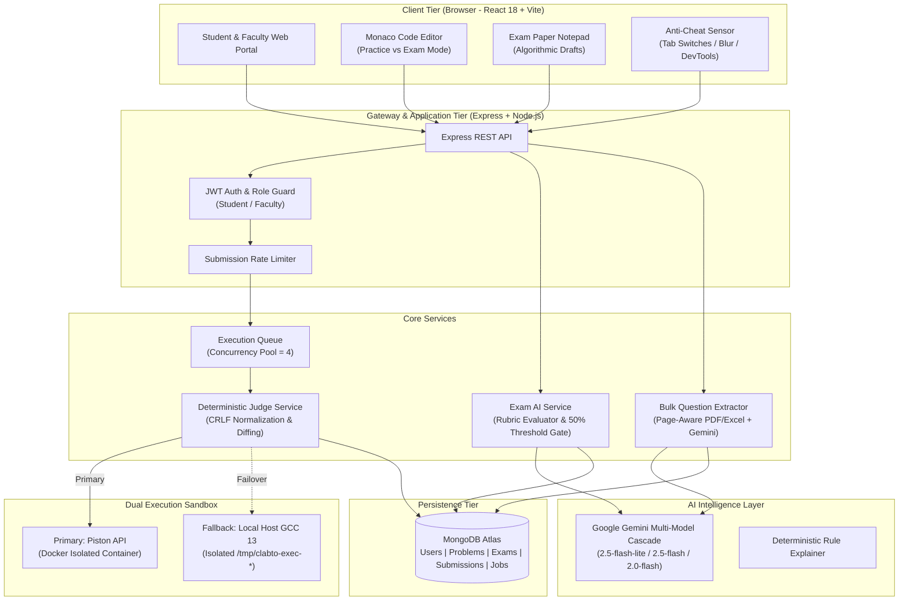

# CLABTOPro — AI-Powered Online Judge & Examination Management Platform

[](https://nodejs.org/)
[](https://react.dev/)
[](https://vitejs.dev/)
[](https://www.mongodb.com/atlas)
[](https://tailwindcss.com/)
[](LICENSE)

**CLABTOPro** is an enterprise-grade academic platform built for C programming laboratories and college examinations. Designed for high concurrency (120+ active lab students), it integrates an automated **Deterministic Online Judge**, **Dual-Engine Sandboxed Execution** (Piston Docker + Local GCC 13), an **Evidence-Based AI Learning Assistant**, and an **Autonomous AI Examination Management Engine** with strict 1-to-1 question allocation, conceptual paper evaluation, and bulk PDF/Excel question ingestion.

---

## Key Highlights & Innovations

- **Dual-Engine Sandboxed C Execution:** Executes student C code in micro-containers (Piston) with an automated, isolated Local GCC 13 fallback runner (`/tmp/clabto-exec-*`) ensuring zero downtime if Docker is offline.
- **AI-Powered Examination Gateway:** Multi-stage student exam state machine with a mandatory academic integrity oath, strict 1-to-1 Fisher-Yates question allocation, and an authoritative **50% Conceptual Error Threshold Gate** on written algorithmic answers before compiler unlock.
- **Exam Mode Code Editor:** Distraction-free, cheating-resilient Monaco editor in examination mode with autocomplete, IntelliSense, parameter hints, and snippet suggestions strictly disabled.
- **Bulk Question Upload & AI Extraction Pipeline:** Ingests up to 200 questions via PDF or Excel spreadsheets with page-aware running header/footer exclusion, multi-factor content classification (`text`, `pattern`, `matrix`, etc.), exact monospace whitespace preservation (stars, centered pyramids, hollow squares, diamonds, Floyd's triangle), and interactive matrix rendering.
- **Evidence-Based AI Tutoring:** When a student's practice submission fails, a multi-model Google Gemini cascade (`gemini-2.5-flash-lite`, `gemini-2.5-flash`) provides root-cause diagnostic hints without giving away answers or facilitating cheating.
- **Proctoring & Anti-Cheat Auditing:** Real-time client-side tracking of browser tab switches, window blurring, and developer tool activity, synced directly to submission audit trails.

---

## System Architecture



---

## Technology Stack

| Layer | Technologies |
| :--- | :--- |
| **Frontend** | React 18, Vite 8.2, Tailwind CSS, Monaco Editor, Lucide React, Axios, React Router v6 |
| **Backend** | Node.js (v18+), Express.js, Mongoose ODM, JSON Web Tokens (JWT), Multer, XLSX, PDF-Parse, Poppler (`pdftotext`) |
| **Database** | MongoDB Atlas / Local MongoDB (WiredTiger Storage Engine) |
| **Code Sandbox** | Piston (Docker containerized execution) + Local GCC 13 (Ubuntu sandbox) |
| **Artificial Intelligence** | Google Gemini API (`gemini-2.5-flash-lite`, `gemini-2.5-flash`, `gemini-2.0-flash`) |
| **Deployment** | Backend: Render / Docker; Frontend: Vercel; Database: MongoDB Atlas |

---

## Directory Structure

```text
Major_Project/
├── backend/
│   ├── configs/                 # MongoDB database connection
│   ├── controllers/             # Request handlers
│   │   ├── adminController.js               # Faculty analytics & student roster
│   │   ├── authController.js                # Authentication & JWT registration
│   │   ├── examController.js                # Exam lifecycle & student state machine
│   │   ├── examQuestionUploadController.js  # Bulk PDF/Excel upload & review
│   │   ├── problemController.js             # Practice problem bank CRUD
│   │   ├── progressController.js            # Daily streaks & topic mastery
│   │   ├── submissionController.js          # Code judging submission pipeline
│   │   └── topicController.js               # Curriculum categorization
│   ├── middleware/              # Auth, Admin RBAC, and Rate Limiting
│   ├── models/                  # Mongoose data schemas
│   │   ├── Exam.js                          # Examination definitions
│   │   ├── ExamAllocation.js                # 1-to-1 student-question mapping
│   │   ├── ExamAnswerSubmission.js          # Written conceptual papers & AI scores
│   │   ├── ExamAuditLog.js                  # Exam proctoring audit trails
│   │   ├── ExamCodeSubmission.js            # Exam code executions & hidden results
│   │   ├── ExamQuestion.js                  # Exam questions & custom rubrics
│   │   ├── Problem.js                       # Practice problems & test cases
│   │   ├── Progress.js                      # Practice streaks & solved counts
│   │   ├── QuestionExtractionJob.js         # Bulk extraction jobs & batch telemetry
│   │   ├── StudentExamProgress.js           # Authoritative exam state machine
│   │   ├── Submission.js                    # Practice submission records
│   │   ├── Topic.js                         # Syllabus topics
│   │   └── User.js                          # User credentials & roles
│   ├── routes/                  # Express API route declarations
│   ├── services/                # Business logic & integrations
│   │   ├── aiEvaluationService.js           # Practice failure diagnostics
│   │   ├── examAIService.js                 # Rubric scoring & 50% threshold gate
│   │   ├── judgeService.js                  # Deterministic output evaluation
│   │   ├── localGccService.js               # Sandboxed GCC 13 host runner
│   │   ├── pistonService.js                 # Piston Docker HTTP execution client
│   │   ├── questionExtractionOrchestrator.js# Background batch question ingestion
│   │   ├── questionExtractorAIService.js    # Gemini batch structuring & confidence
│   │   ├── questionParserService.js         # PDF/Excel layout parsing & boundaries
│   │   └── submissionQueue.js               # Concurrency worker pool (max = 4)
│   ├── tests/                   # Automated Node test runner suites (27 tests)
│   │   ├── bulkQuestionUpload.test.js       # Extraction, boundaries, scaling tests
│   │   └── exam.test.js                     # Judging, threshold, error calc tests
│   ├── utils/                   # Text normalization, entity decoding & dedenting
│   ├── Dockerfile               # Production container with GCC 13
│   ├── package.json
│   └── server.js                # Server bootstrap & process lifecycle
├── frontend/
│   ├── public/                  # Static assets & sample PDF template
│   ├── src/
│   │   ├── components/          # Reusable UI components
│   │   │   ├── common/                      # Loaders, Navbar, Protected routes
│   │   │   ├── exam/                        # Upload modal, Preview & review modal
│   │   │   ├── layout/                      # Admin & Student shell layouts
│   │   │   └── problem/                     # Monaco editor, tabs, proctoring
│   │   ├── pages/               # Application views
│   │   │   ├── admin/                       # Dashboard, Exams, Problems, Students
│   │   │   └── student/                     # Exams, Instructions, Notepad, Editor
│   │   ├── routes/                          # React Router definitions
│   │   ├── services/                        # Axios API wrappers
│   │   └── utils/                           # C language syntax definitions
│   ├── package.json
│   └── vite.config.js
├── DOCUMENTATION.md             # Comprehensive Technical & Reference Manual
├── SYSTEM_DESIGN.md             # High-level architecture & design specifications
├── docker-compose.piston.yml    # Offline Piston execution container config
└── docker-compose.yml           # Full-stack Docker deployment config
```

---

## Core Modules & Features

### 1. Practice & Learning Platform
- **Problem Bank & Topics:** Categorized by C curriculum modules (Loops, Arrays, Pointers, Strings, Recursion, Matrices, Structures).
- **In-Browser IDE:** Syntax highlighting, line numbers, bracket matching, and indentation powered by Monaco Editor.
- **Deterministic Judge:** Evaluates submissions against visible sample tests and hidden test cases under wall-clock limits (default 3000ms).
- **Evidence-Based AI Debugging:** Diagnostic hints triggered on test failures without revealing source code solutions.
- **Anti-Cheat Proctoring:** Tracks window focus loss (`blur`) and tab switching (`visibilitychange`) during submissions.
- **Analytics & Leaderboard:** Streaks, daily submission activity, and ranking based on points and problem difficulty.

### 2. AI-Powered Examination Engine
- **Internal & External Exams:** Supports semester internals, laboratory lab-externals, and practice tests.
- **1-to-1 Fisher-Yates Question Allocation:** Strictly unique problem assignment per student, guaranteed by compound database indexes.
- **Student Exam State Machine:** Server-authoritative transitions:
  $$\text{not\_started} \longrightarrow \text{instructions\_acknowledged} \longrightarrow \text{question\_assigned} \longrightarrow \text{answer\_in\_progress} \longrightarrow \text{evaluation\_pending} \longrightarrow \text{execution\_allowed} \longrightarrow \text{completed}$$
- **Algorithmic Paper Notepad:** Students draft algorithm outlines, logic flow, and edge cases.
- **50% Conceptual Error Threshold Gate:** Evaluates paper drafts against rubric criteria (Logic 30%, Algorithm 25%, Syntax 20%, Efficiency 15%, Constraints 10%). Compiler access remains strictly locked until:
  $$\text{Conceptual Error} < 50\%$$
- **Exam-Hardened Editor:** Monaco Editor in exam mode strictly disables autocomplete, IntelliSense popups, parameter hints, and code snippets.
- **Live Faculty Monitoring:** Real-time candidate tracking (conceptual error %, attempts used, compiler unlocked state, test verdicts).

### 3. Bulk Question Upload & AI Extraction Pipeline
- **PDF & Excel Ingestion:** Ingests documents with up to 160–200 questions in a single upload.
- **Page-Aware Header/Footer Isolation:** Eliminates running document footers (e.g., `ClabToPro ... Page 7`) and header markers using coordinate bounding boxes and repeating signature filters.
- **Multi-Factor Content Classifier:** Categorizes into `text`, `pattern`, `matrix`, `math`, `code`, or `table`. Array and sorting problems are never misclassified as patterns.
- **Whitespace & Geometric Pattern Preservation:** Preserves newlines and spaces for stars, centered pyramids, hollow squares, diamonds, number triangles, and Floyd's triangle (`white-space: pre`).
- **Interactive Matrix Rendering:** Extracts 2D grids into structured JSON (`{ type: "matrix", rows, columns, values }`) rendered as interactive HTML coordinate tables.
- **Confidence Scoring & Review:** Automatically validates complete extractions as `status: "approved"`. Only suspicious or truncated questions are flagged for faculty review.
- **Downloadable Template:** One-click sample question paper PDF template available directly from the upload modal.

---

## Quick Start & Installation

### Prerequisites
- **Node.js:** v18.0.0 or higher
- **MongoDB:** MongoDB Atlas account or local MongoDB instance (v6.0+)
- **GCC Compiler:** `gcc` (v13 recommended) installed on the host system
- **Poppler Utilities:** `pdftotext` and `pdftoppm` for PDF extraction (optional OCR with `tesseract`)
- **Docker (Optional):** For local Piston isolated micro-container execution

```bash
# Ubuntu / Debian prerequisites installation
sudo apt-get update
sudo apt-get install -y build-essential gcc poppler-utils tesseract-ocr
```

### 1. Clone Repository & Setup Backend
```bash
git clone https://github.com/your-org/clabtopro.git
cd clabtopro/backend

# Install backend dependencies
npm install

# Configure environment variables
cp .env.example .env  # or edit .env
```

**Required `backend/.env` settings:**
```env
PORT=3400
MONGODB_URI=mongodb+srv://<user>:<password>@cluster.mongodb.net/clabtopro?retryWrites=true&w=majority
JWT_SECRET=your_super_secret_jwt_key_here
GEMINI_API_KEY=your_google_gemini_api_key_here
GEMINI_MODEL=gemini-2.5-flash-lite

# Piston Sandbox Configuration
PISTON_URL=http://localhost:2000/api/v2
ENABLE_LOCAL_GCC_FALLBACK=true
EXECUTION_CONCURRENCY=4
EXECUTION_TIMEOUT_MS=3000
```

### 2. Setup Frontend
```bash
cd ../frontend

# Install frontend dependencies
npm install

# Configure environment variables
cp .env.example .env
```

**Required `frontend/.env` settings:**
```env
VITE_API_URL="http://localhost:3400/api"
```

### 3. Run Development Servers
```bash
# Terminal 1: Start Backend (Port 3400)
cd backend
npm run dev

# Terminal 2: Start Frontend (Port 5173)
cd frontend
npm run dev
```

Visit `http://localhost:5173` in your browser.

---

## Testing & Quality Assurance

The project includes automated regression test suites executed via the native Node.js test runner (`node:test`):

```bash
# Run all backend test suites
cd backend
node --test tests/bulkQuestionUpload.test.js tests/exam.test.js
```

**Test Coverage Highlights (27 Tests, 100% Passing):**
- **Bulk Upload & Extraction:** Question boundary regex, Excel tabular and single-cell parsing, 200-question batch processing, 30-question PDF extraction (Q1–Q30 sequential, zero phantom questions), footer contamination resilience, and whitespace preservation for all 8 pattern types.
- **Judge & Sandboxing:** Correct code (Accepted), incorrect code (Wrong Answer), syntax errors (Compile Error), crash handling (Runtime Error), and CRLF output normalization.
- **Examination Engine:** Authoritative 50% conceptual error calculation, rubric penalty weighting, test case sanitization, and Fisher-Yates 1-to-1 allocation integrity.

---

## Detailed Manuals

For exhaustive architecture documentation, complete API endpoint specifications, student & faculty user manuals, and deployment runbooks, refer to:
- **[Full Technical & Reference Manual (DOCUMENTATION.md)](./DOCUMENTATION.md)**
- **[System Design & Architecture Specifications (SYSTEM_DESIGN.md)](./SYSTEM_DESIGN.md)**

---

## License

This project is licensed under the MIT License — see the [LICENSE](LICENSE) file for details.
