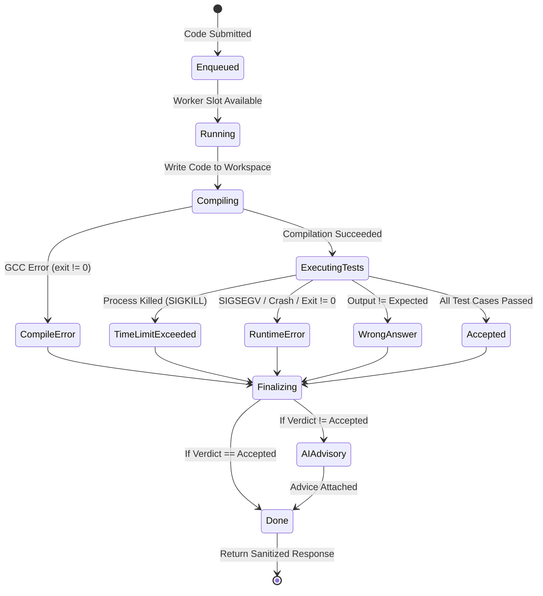
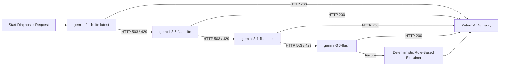
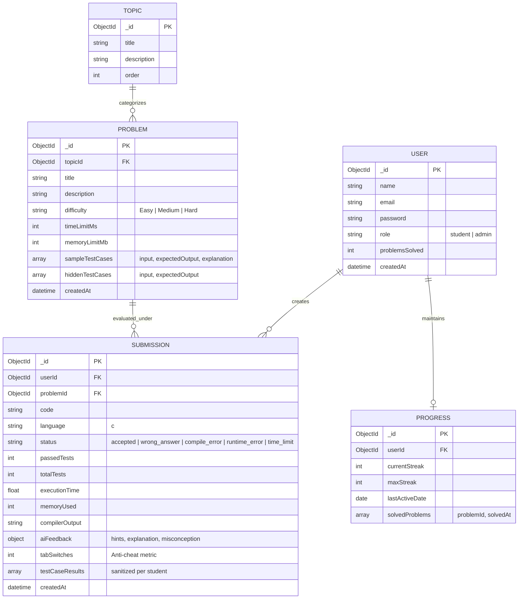

# CLABTOPro — System Design Document

**System Name:** CLABTOPro (C-Laboratory Online Judging & AI Tutoring Platform)  
**Document Version:** 1.0.0  
**Target Audience:** Software Architects, Lead Developers, Academic Instructors, DevOps Engineers  

---

## 1. Executive Summary & Requirements Engineering

CLABTOPro is a high-reliability, cloud-ready online judge, automated evaluation engine, and intelligent laboratory tutoring platform tailored for C programming courses in academic institutions (designed for ~120+ concurrent active laboratory students).

### 1.1 Functional Requirements
1. **Interactive Coding & Submission:** Students write, compile, test, and submit C programs directly in an in-browser IDE with syntax highlighting and autocompletion.
2. **Deterministic Online Judge:** Automated verification of student code against both visible (sample) and hidden test suites under strict time (wall-clock) and memory constraints.
3. **Dual Execution Sandboxing:** Safe execution of untrusted C code via isolated micro-containers (Piston) with an automated, containerized Local GCC fallback runner.
4. **AI-Powered Tutoring & Explanations:** Non-authoritative, evidence-based feedback on failed submissions providing root-cause diagnostic hints without giving away direct solutions or cheating answers.
5. **Proctoring & Anti-Cheat Auditing:** Real-time client-side tracking of browser tab switching, window blurring, and developer tool activity, synced to submission audit logs.
6. **Curriculum, Progress & Analytics:** Role-Based Access Control (RBAC) supporting Students and Administrators/Instructors. Tracks daily problem-solving streaks, topic mastery, performance analytics, and class-wide submission health.

### 1.2 Non-Functional Requirements
- **Determinism:** 100% reproducible test case judgements (AI never determines or modifies execution verdicts).
- **Security & Multi-Tenant Isolation:** Complete isolation of student code execution to prevent system resource exhaustion, fork bombs, unauthorized file access, or socket creation.
- **Test Confidentiality:** Strict zero-leakage policy for hidden test case inputs and expected outputs.
- **High Availability & Fault Tolerance:** Automatic engine fallback (Piston -> Local GCC) and multi-model AI cascade to prevent service degradation during network or quota spikes.
- **Low Latency:** Visible sample runs returned in under 1.5 seconds; full evaluations completed in under 3.5 seconds.
- **Controlled Concurrency:** Enforced worker pools to eliminate host CPU thrashing during burst submissions (e.g., class-wide lab deadlines).

---

## 2. High-Level Architecture (HLD)

CLABTOPro follows a decoupled, layered micro-architecture comprising an interactive Single Page Application (SPA), a centralized API Gateway & Application Controller, an asynchronous execution queue, a dual-engine execution sandbox, an AI advisory layer, and a managed document database.

```mermaid
flowchart TD
    subgraph Client Tier ["Client Tier (Browser)"]
        UI["React 18 SPA (Vite + Tailwind)"]
        Editor["Monaco / CodeMirror Editor"]
        Proctor["Restriction & Proctoring Hook\n(Tab / Blur / Visibility)"]
    end

    subgraph Gateway Tier ["API & Routing Tier (Render)"]
        Proxy["Reverse Proxy / Express Server"]
        AuthMiddleware["JWT Auth & RBAC Guard"]
        Sanitizer["Payload Sanitizer & Output Normalizer"]
    end

    subgraph Execution Tier ["Execution & Judging Tier"]
        Queue["Submission Queue\n(Bounded Concurrency = 4)"]
        Judge["Deterministic Judge Service"]
        Piston["Primary: Piston API (Docker Sandboxed)"]
        LocalGCC["Fallback: Sandboxed Local GCC Runner\n(/tmp/clabto-exec-*)"]
    end

    subgraph Intelligence Tier ["Advisory Tier"]
        AICascade["AI Evaluation Service\n(Multi-Model Cascade)"]
        M1["gemini-flash-lite-latest"]
        M2["gemini-3.5-flash-lite"]
        M3["gemini-3.1-flash-lite"]
        M4["gemini-3.6-flash"]
        FallbackRule["Rule-Based Diagnostic Fallback"]
    end

    subgraph Persistence Tier ["Data Tier"]
        Mongo[("MongoDB Atlas Database\nUsers | Problems | Submissions | Progress")]
    end

    UI -->|HTTP / REST + JWT| Proxy
    Editor -->|Code Payload| Proxy
    Proctor -->|Cheat Metrics: tabSwitches| Proxy

    Proxy --> AuthMiddleware
    AuthMiddleware --> Sanitizer
    Sanitizer --> Queue

    Queue --> Judge
    Judge -->|Primary Try| Piston
    Judge -.->|On Failure/Offline| LocalGCC

    Judge -->|Persist Verdict & Stats| Mongo
    Judge -->|If Failed: Request Diagnostic| AICascade

    AICascade --> M1
    M1 -.->|503 Failover| M2
    M2 -.->|503 Failover| M3
    M3 -.->|503 Failover| M4
    M4 -.->|All Quotas Exhausted| FallbackRule

    AICascade -->|Append Feedback| Mongo
    Sanitizer -->|Sanitized Result (No Hidden Tests)| UI
```

---

## 3. Component Deep Dive

### 3.1 Client Tier
- **Framework:** React 18 with Vite build tooling and Tailwind CSS for utility-first styling.
- **Code Editor:** Monaco/CodeMirror configured for C11 syntax highlighting, auto-indentation, and bracket matching.
- **Proctoring Engine (`RestrictionContext.jsx`):**
  - Listens to `document.visibilitychange`, `window.onblur`, and `fullscreenchange`.
  - Increments tab switch counters and records incident timestamps.
  - Triggers interactive warning modals when students leave the laboratory viewport.
  - Automatically attaches proctoring metadata to all evaluation network requests.

### 3.2 API & Control Tier
- **Runtime:** Node.js 20 LTS running Express.
- **Authentication:** Stateless JSON Web Tokens (JWT) signed with HMAC-SHA256, carrying user ID and role (`student` vs `admin`).
- **Input Sanitization & Output Normalization:**
  - Converts mixed carriage return line endings (`\r\n` and `\r`) to unified line feeds (`\n`).
  - Trims trailing whitespace per line and eliminates trailing blank lines to prevent false negative test failures.
  - Filters all outgoing submission records through `sanitizeSubmissionForStudent`, completely stripping hidden test inputs, outputs, and internal execution paths before sending to client.

### 3.3 Concurrency Control & Worker Pool
- **Module:** `submissionQueue.js`
- **Mechanism:** In-memory queue with an active worker concurrency semaphore (`EXECUTION_CONCURRENCY = 4`).
- **Queue Logic:**
  - Submissions are accepted and assigned a promise.
  - If active workers `< EXECUTION_CONCURRENCY`, execution starts immediately.
  - If workers are saturated, submissions wait in a FIFO queue.
  - Prevents denial-of-service (DoS) from fork bombs, runaway loops, or simultaneous submissions at the end of class lab hours.



---

## 4. Execution Engine & Dual Sandboxing

To balance speed, cloud host compatibility, and multi-tenant security, the platform employs a **Dual-Engine Execution Architecture**:

```
                       ┌─────────────────────────┐
                       │  Code Execution Request │
                       └────────────┬────────────┘
                                    │
                                    ▼
                       ┌─────────────────────────┐
                       │   Is Piston Available?  │
                       └──────┬────────────┬─────┘
                         YES  │            │ NO
                              ▼            ▼
                   ┌────────────────┐  ┌─────────────────────────┐
                   │  Piston API    │  │  Local GCC Sandbox      │
                   │  Container     │  │  (/tmp/clabto-exec-*)   │
                   └──────┬─────────┘  └───────────┬─────────────┘
                          │                        │
                          └───────────┬────────────┘
                                      ▼
                         ┌─────────────────────────┐
                         │ Deterministic Evaluator │
                         │ (Outputs, Limits, Diff) │
                         └─────────────────────────┘
```

### 4.1 Primary Engine: Isolated Piston API
- **Protocol:** HTTP REST (`/api/v2/execute`) to a containerized Piston engine.
- **Sandboxing:** Employs Linux namespaces, cgroups, user isolation, and `chroot`.
- **Resource Constraints:**
  - Memory Limit: 128 MB
  - Compile Timeout: 5,000 ms
  - Run Timeout: 3,000 ms per test case
  - Max Processes: Restricted to prevent fork bombs.

### 4.2 Fallback Engine: Containerized Local GCC Sandbox
- **Module:** `localGccService.js`
- **Execution Mechanism:**
  1. Creates an isolated temporary directory: `/tmp/clabto-exec-<random_uuid>/`.
  2. Writes student source code to `solution.c`.
  3. Invokes GCC compiler with standard flags:
     ```bash
     gcc -O2 -Wall -std=c11 solution.c -o solution -lm
     ```
  4. Spawns child process for each test case feeding input via standard input stream (`stdin`).
  5. **Stream Fault Protection:** Attaches `child.stdin.on('error', ...)` handler to intercept and silence `write EPIPE` exceptions if the binary crashes before reading full input.
  6. **Hard Wall-Clock Guards:** Wraps execution in `setTimeout` that fires `child.kill('SIGKILL')` if process execution exceeds timeout limit (default: 3,000 ms).
  7. **Guaranteed Cleanup:** Employs `fs.rm(execDir, { recursive: true, force: true })` inside a `finally` block to guarantee disk space reclamation.

---

## 5. AI Advisory Subsystem & Multi-Model Cascade

### 5.1 Non-Authoritative Architecture
- The AI never evaluates code, calculates grades, or assigns verdicts.
- Deterministic test execution is the **single source of truth**.
- Gemini AI is invoked **only** on non-accepted verdicts (`compile_error`, `runtime_error`, `wrong_answer`, `time_limit`).
- It receives:
  - Source code snippet
  - Compiler error messages or runtime signal names
  - Visible sample test case mismatch (hidden test cases are omitted or masked)
- Prompt guidelines instruct the AI to act as a Socratic laboratory tutor: explain *why* the error happened, identify the conceptual misconception, and suggest verification steps without generating complete replacement code.

### 5.2 Multi-Model Failover Resilience
To eliminate downtime caused by Google Gemini HTTP 503 ("spikes in demand") errors, the service implements a cascading failover policy:



1. **Tier 1:** `gemini-flash-lite-latest` (fastest latency, high throughput)
2. **Tier 2:** `gemini-3.5-flash-lite` (fallback lightweight variant)
3. **Tier 3:** `gemini-3.1-flash-lite` (stable secondary variant)
4. **Tier 4:** `gemini-3.6-flash` (higher capacity standard model)
5. **Tier 5:** Deterministic Rule-Based Diagnostics (synthesizes structured regex analysis for syntax errors, common segfault causes, and infinite loop warnings if external networks fail completely).

---

## 6. Data Architecture & Database Models

The persistence layer uses MongoDB Atlas. Below is the Entity-Relationship Diagram (ERD):



---

## 7. Security, Sandboxing & Threat Modeling

| Threat Vector | Mitigation Strategy | Implementation |
| :--- | :--- | :--- |
| **Malicious Code Execution** (System file modifications, unauthorized network requests) | Disallow network access; run within isolated Linux containers (Piston) or throwaway unprivileged directories (`localGccService`). | `chroot` / cgroups in Piston; non-root user execution; no socket permissions. |
| **Fork Bombs / Infinite Loops** | Wall-clock execution timeouts and process count caps. | `SIGKILL` dispatched after 3,000 ms; Piston `max_processes = 32`. |
| **Stream Crashes (`write EPIPE`)** | Safe child process stdin pipeline management. | `child.stdin.on('error', noop)` handler catches pipe breakage when binaries crash before consuming input. |
| **Hidden Test Case Leakage** | Complete schema sanitization before wire transmission. | `sanitizeSubmissionForStudent` strips `hiddenTestCases`, exact inputs, and expected outputs. |
| **Academic Dishonesty / Tab Switching** | Real-time viewport focus tracking and persistent logging. | `RestrictionContext` syncs `tabSwitches` count and timestamps directly into `Submission` records for instructor audit. |
| **Denial of Service (Burst Submissions)** | Bounded concurrency worker pool. | `submissionQueue.js` limits concurrent active compilation/execution tasks to `4`. |

---

## 8. Deployment & Infrastructure Topology

The production setup uses a zero-maintenance cloud container topology:

```
                            ┌────────────────────────┐
                            │      Vercel CDN        │
                            │ (React Single Page App)│
                            └───────────┬────────────┘
                                        │ HTTPS
                                        ▼
                            ┌────────────────────────┐
                            │    Render Web Service  │
                            │ (Node 20 + GCC 12/13)  │
                            └─────┬────────────┬─────┘
                                  │            │
            ┌─────────────────────┘            └──────────────────────┐
            ▼                                                         ▼
┌────────────────────────┐                                ┌────────────────────────┐
│     MongoDB Atlas      │                                │  Google Generative AI  │
│   (Managed Replica)    │                                │     (Gemini API)       │
└────────────────────────┘                                └────────────────────────┘
```

- **Frontend:** Hosted on Vercel with automatic edge SSL and single-page routing rewrites.
- **Backend:** Hosted on Render using a specialized production container:
  ```dockerfile
  FROM node:20-bookworm-slim
  RUN apt-get update && apt-get install -y --no-install-recommends \
      build-essential gcc libc6-dev make && rm -rf /var/lib/apt/lists/*
  WORKDIR /usr/src/app
  COPY package*.json ./
  RUN npm ci --only=production
  COPY . .
  EXPOSE 5000
  CMD ["node", "server.js"]
  ```
- **Execution Engine:** Because GCC 12/13 is pre-installed directly inside the container, the backend operates independently with full compilation and execution capabilities even when external Docker-in-Docker is restricted.
- **Monitoring & Health Checks:** Exposed endpoint at `/api/execution/health` reporting live compilation readiness, active engine name, GCC version, and queue status.
